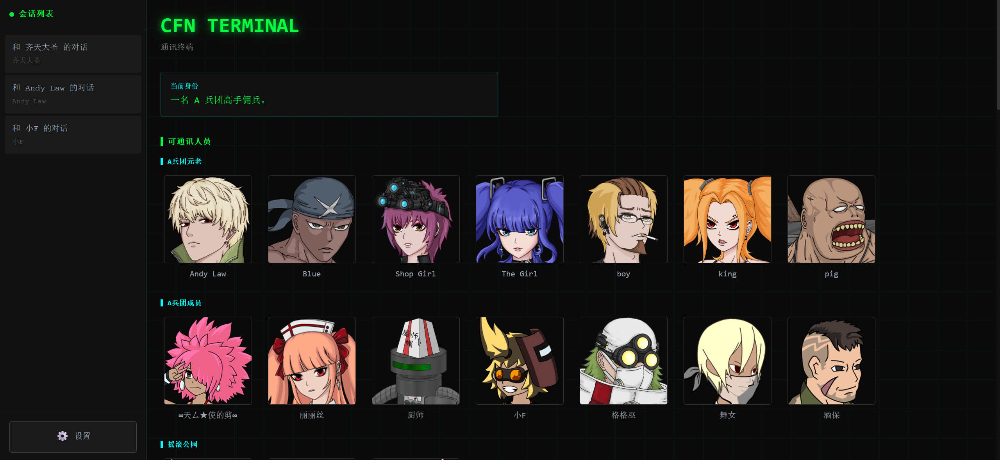

# CFN-RAG Backend（cfn-rag-backend）

[](https://opensource.org/licenses/MIT)

CFN-RAG 后端是 [Crazy Flash Night (CFN)](https://github.com/FlashNightModReborn/CrazyFlashNight) 的**本地 AI 对话服务**：让游戏里的 NPC 能跟玩家聊天、谈判并发布委托，玩家也能在 NPC 说话过程中随时插话。它内置游戏数据的本地检索（RAG）、跨会话长期记忆和对话改写能力，既可以在浏览器里当独立终端使用，也可以由游戏直接拉起、嵌在游戏窗口里运行。

服务只监听 `127.0.0.1`，按单用户本地运行。游戏数据一律只读，运行期的写入只落在专门的增量文件和本地数据库中，不改动游戏原始数据。前端终端界面是独立仓库：[cfn-terminal-web](https://github.com/aka-flashNight/cfn-terminal-web)。从 V3.0.0 起，前端与后端需要配套升级。

## 预览



## 主要功能

下面按功能模块列出这个项目提供的主要能力。每节第一句是它解决的问题，后面的要点是玩家实际能看到的表现。

### 架构速览：一次对话是怎么跑完的

```text
浏览器终端 / 游戏内嵌面板
        │  玩家发言
        ▼
   回合编排 ──┬── 组装上下文：NPC 身份与说话方式、所在场景、好感度与关系、长期记忆、本会话摘要
             └── 本地检索游戏数据（混合检索：向量 + BM25 + RRF）
        ▼
   大模型（任意 OpenAI 兼容接口，流式返回）
        ├── 先到：情绪 + 好感度变化 → 前端立刻换立绘、更新好感度条
        ├── 再到：台词增量 → 边生成边显示
        └── 如果这一轮触发了耗时动作
                 ▼
        后台子 Agent（发布委托 / 查资料 / 改写对话）
                 │  前台 NPC 先说一句过渡话，办完把结果接回同一轮对话
                 ▼
        玩家看到的始终是同一个 NPC 在连续说话
```

- 后端是单个本地进程，只监听 `127.0.0.1:7077`，同时提供 API 和前端页面
- 游戏数据一律只读，运行期的写入只落在增量文件和本地数据库里
- 与存档有关的数据（委托、对话覆盖层、会话、好感度、长期记忆）按存档槽位分开存放

### NPC 角色扮演对话

**跟游戏里的 NPC 聊天，对方按自己的身份、性格、所在场景和当前情绪说话。**

- 角色资料来自游戏数据：身份、阵营、头衔、形象描述、说话方式，以及与玩家的关系
- 回答内容以游戏设定为依据，世界观、剧情、情报、物品、关卡等由检索层提供
- **情绪与好感度**：每回合先给出情绪和好感度变化，前端立刻切换立绘、更新好感度条；好感度和关系等级长期保留
- **流式对话**：台词边生成边显示，模型还在输出时玩家就能看到文字，不用等整段回复

### 委托发布与协商

**在对话里谈成一笔委托，谈妥之后写进游戏，可以正常接取和完成。**

- 流程是「拟定草案 → 讨价还价或局部修改 → 玩家明确确认 → 正式发布」。拟定草案不等于发布，全程由玩家决定
- 发布前会做校验（物品、关卡、进度、奖励预算、等级匹配）：能自动微调的直接调好；需要模型改的，连同原因和修正方向退回重试一次；仍不通过还有兜底路径，不会让玩家什么都拿不到
- 发布后的委托出现在游戏任务列表里，与游戏原有委托一样可以接取和完成
- **物品交互**：对话和插话中 NPC 可以赠送物品，也可以向玩家索取物品；数量和价值都有校验，同一次请求不会重复领取
- **任务完成联动**：游戏把任务完成事件回传给后端，带对话改写标记的委托会自动触发相关 NPC 的后续对话改写

### 对话插话（游戏内）

**NPC 台词播放到一半，玩家可以随时插一句话。**

- 插话结果流式返回，可以新增台词、改写还没播的台词、删掉还没播的台词，或直接结束这段对话
- 选项轮里可以直接执行动作：接受或拒绝委托、赠送或索取物品
- 插话和终端聊天共用同一套 NPC 资料、场景信息、说话方式规则和模型配置
- 插话内容解析失败时会降级处理，不影响已经播出的台词

### 长期记忆

**NPC 记得和你发生过什么，换个会话、换个对话窗口也记得。**

- 按「存档 + NPC」保存基础印象和关键事件，聊天过程中由模型按规则更新
- 与会话内的滚动摘要各自独立：摘要负责本次对话的连贯，长期记忆负责跨会话的关系

### 对话改写

**让 NPC 改自己的台词，或者改已发布委托的文本。**

- 玩家用自然语言提出改动，后台子 Agent 找到对应文本并修改，完成后回到对话里说明结果
- 改动只写进单独的覆盖层文件，只记录被改过的条目，按存档互相隔离，游戏原始的对话与委托文件保持原样

### 会话管理

- 多会话、历史分页、重命名与删除
- 会话列表和历史按当前存档过滤，换存档不会看到另一个存档的对话
- 会话、消息、摘要、委托草案和长期记忆都保存在本地数据库里

### 游戏知识库检索（Hybrid RAG）

**回答之前先在游戏数据里查资料，减少凭空编造。**

- 混合检索：稠密向量 + BM25 + RRF 融合，按对话、委托、世界观、情报、实体等分池检索，覆盖游戏设定、角色台词、委托、物品与关卡等话题
- 嵌入模型是 bge-small-zh-v1.5 的 ONNX int8 量化版，完全在本地运行；单条查询编码约 1 ms，一轮检索通常在 150 ms 以内
- 索引按游戏数据是否变化自动判断要不要重建，重建在后台进行，不阻塞使用
- 玩家改写过的对话和委托文本会直接体现在检索结果里，不需要为此重建索引
- 设置页可以手动重建知识库，适合大批量数据更新之后使用

### 多 Agent 后台并行

**耗时的事交给后台办，前台 NPC 一直在说话。**

- 发布委托、查资料、改写对话由后台子 Agent 执行
- 前台 NPC 先给一句过渡话，后台办完再把结果接回同一轮对话
- 玩家看到的是同一个 NPC 在连续说话，不会卡在等待界面

### 多模态立绘与头像

- 使用支持视觉的模型时，请求会带上 NPC 当前情绪的立绘；模型不支持视觉时自动改为纯文本，其余功能不受影响
- 立绘和头像直接读游戏项目里的资源，游戏更新立绘后立即生效，不需要另外下载立绘包
- 找不到对应资源时自动改为不带图运行，对话照常

### 游戏内嵌终端与存档绑定

**终端就在游戏里，不用另开浏览器，也不用手动告诉它你在玩哪个存档。**

- 游戏宿主直接拉起后端，面板嵌在游戏窗口里打开，没有地址栏、不另开窗口
- 宿主把当前存档的槽位、玩家信息、进度和场景推送给后端；后端不会自己去读游戏存档文件
- 委托、委托文本、对话覆盖层、会话、NPC 好感与关系、长期记忆都按存档槽位隔离；与存档无关的静态信息（阵营、头衔、形象描述等）在所有存档之间共享
- 游戏设置里可以选择启动游戏时自动拉起终端；游戏退出时终端一起正常关闭

### 模型接入

- 任何 OpenAI 兼容接口都能接入，在设置页填 API Key / API Base / 模型名即可
- 内置模型 Profile 用来决定是否发送思考参数和图片；平台不识别某个参数时会自动去掉后重试一次
- 未收录的模型走默认 Profile，不需要额外配置
- **委托发布、讨价还价、物品交互等功能需要平台支持工具调用（function calling）**；不支持工具调用的平台只能聊天

### 部署形态

- **单文件 exe**（约 92 MB）：内置前端页面、int8 嵌入模型和初始数据文件，放在游戏目录旁边即可运行
- **独立体验 zip**：连精简游戏数据、NPC 立绘和头像一起打包，解压双击就能聊天，不需要游戏本体、Python、额外模型或索引
- **源码运行**：开发调试用，功能与打包版一致
- 日志写在 exe 同目录的 `cfn-rag.log`

## 运行形态与目录要求

后端支持三种运行方式，按自己的情况选一种即可。

### 形态一：游戏内嵌（已有游戏时推荐）

把带版本号的 exe 放在**游戏数据根目录的同一级**。

**Steam 独立版**：游戏数据根目录是 `resources`，exe 放在 `CRAZYFLASHER7StandAloneStarter` 下：

```text
steamapps/common/CRAZYFLASHER7StandAloneStarter/
├── resources/                 # 游戏数据根（含 data/、docs/story/、flashswf/、launcher/）
└── CFN-RAG-v3.0.0.exe         # 放在这里，不要改文件名
```

**GitHub 拉取的重置版项目**：仓库默认目录名是 `CrazyFlashNight`，exe 放在它的同一级：

```text
任意父目录/
├── CrazyFlashNight/           # 游戏项目根（含 data/、docs/story/、flashswf/、launcher/）
└── CFN-RAG-v3.0.0.exe
```

启动游戏后，从游戏内的平板电脑-终端聊天打开面板，也可以从对话框展开插话框打开面板；或在游戏设置中开启「启动游戏时自动启动终端」。

**不要重命名 exe**：游戏宿主按 `CFN-RAG-v*.exe` 的规则自动查找终端程序，改名后可能无法被拉起。

后端会在 exe 同级目录中按 `resources`、`CrazyFlashNight` 的顺序查找游戏数据根，也可以用环境变量 `CFN_RESOURCES_DIR` 显式指定。两个目录同时存在时优先使用 `resources`。

### 形态二：独立体验 zip（没有游戏，只想聊天）

从 [Releases](https://github.com/aka-flashNight/cfn-rag-backend/releases) 下载 `CFN-RAG-Full-v3.0.0.zip`，解压到任意位置，双击 `CFN-RAG-v3.0.0.exe`。

```text
CFN-RAG-v3.0.0/               # 解压出来的顶层目录
├── CFN-RAG-v3.0.0.exe
└── CrazyFlashNight/          # 精简游戏数据 + 立绘 + 头像（随包提供）
```

zip 里已经包含聊天需要的数据、立绘、头像、嵌入模型和前端页面，**不依赖任何外部文件**；不包含游戏本体，也不包含预生成的向量索引（首次启动会在后台自动构建）。独立模式适合体验角色对话和委托草案；在游戏内接取委托、存档联动等能力需要游戏本体。

### 形态三：源码运行（开发者推荐）

```text
父目录/
├── CrazyFlashNight/          # 游戏项目根；Steam 独立版对应 resources/
└── cfn-rag-backend/          # 本项目
```

也可以直接设置 `CFN_RESOURCES_DIR` 指向游戏数据根，不要求与本项目同级。

游戏项目地址：`https://github.com/FlashNightModReborn/CrazyFlashNight`。建议使用 **2026-10-26 及之后**的游戏数据；更早的版本可能缺少 V3 用到的字段，部分功能会降级。

## 快速开始

### 方式一：exe + 已有游戏

1. 从 [Releases](https://github.com/aka-flashNight/cfn-rag-backend/releases) 下载 `CFN-RAG-v3.0.0.exe`
2. 按上面的目录说明放到游戏数据根（`resources` 或 `CrazyFlashNight`）的同一级，保持文件名不变
3. 启动游戏，从游戏内的平板电脑-终端聊天打开面板，也可以从对话框展开插话框打开面板；或在游戏设置中开启「启动游戏时自动启动终端」
4. 首次使用时在终端设置页填写 API Key / API Base / 模型（打包版只读取页面设置，不需要 `.env`）

> 只要游戏整包是 **2026-10-26 之后的每日包或公开整包**，或者用的是 **GitHub 最新游戏项目**，就只需要下载这个 exe，不需要另外下载数据、立绘、头像或其它资源包。

### 方式二：Full zip + 独立体验

1. 从 [Releases](https://github.com/aka-flashNight/cfn-rag-backend/releases) 下载 `CFN-RAG-Full-v3.0.0.zip`
2. 解压到任意位置，双击 `CFN-RAG-v3.0.0.exe`
3. 浏览器会自动打开终端页面，在设置页填写 API Key / API Base / 模型

首次启动会弹出 Windows 防火墙授权，请点「允许」（服务只监听本机回环地址）。启动器窗口保持打开时服务才在运行，关闭窗口即退出。

### 方式三：从源码运行

#### 环境要求

- Python 3.10+
- 约 1 GB 磁盘空间（依赖与嵌入模型）

#### 安装步骤

1. 克隆仓库

```bash
git clone https://github.com/aka-flashNight/cfn-rag-backend.git
cd cfn-rag-backend
```

2. 创建虚拟环境并安装运行时依赖

```bash
python -m venv venv

# Windows PowerShell
.\venv\Scripts\Activate.ps1

# Linux/macOS
source venv/bin/activate

pip install -r requirements.txt
```

3. 准备嵌入模型（一次性，二选一）

运行时只依赖 `models/bge-small-zh-v1.5-onnx-int8/`（ONNX int8 权重不入 git）：

- **直接获取**：从 Release 附件或已有部署复制该目录；
- **自行导出**（开发机）：安装开发依赖，下载原始模型并导出 int8：

```bash
pip install -r requirements-dev.txt
python scripts/download_model.py --modelscope   # 或 --mirror / --proxy http://127.0.0.1:10809
python scripts/export_onnx_int8.py              # 导出并校验 int8（余弦 ≥0.99 自动把关）
```

4. 配置 API Key

复制 `.env.example` 为 `.env` 并填入 API Key（获取方式见下方「模型推荐」）：

```bash
cp .env.example .env
```

5. 启动服务

```bash
python launcher.py
```

浏览器会自动打开界面。`launcher.py` 会同时启动后端（7077）和前端静态服务（7080 起），并对 `/api` 与 SSE 做反向代理。开发时也可以只用 `python -m uvicorn main:app --port 7077` 启动后端，前端另行 `npm run dev`。

## 游戏内嵌集成说明

本节只说明后端提供的能力和接口约定；游戏侧的拉起、面板和存档投影实现属于游戏项目。

### 启动模式

| 模式 | 启动方式 | 端口与页面 |
|------|----------|------------|
| standalone | 用户双击 exe / `python launcher.py` | 后端 7077；前端静态服务 7080 起，用浏览器访问 |
| embedded | 游戏宿主以 `--embedded` 拉起 | 7077 单端口同时提供 API 与前端页面；面板 iframe 使用 `http://127.0.0.1:7077` |

embedded 模式不跳转浏览器、不播放启动提示音、不显示独立状态窗，只写 `cfn-rag.log`。同一时间只允许一个实例占用 7077；已有实例在服务时，新拉起的 embedded 进程会静默退出，由宿主继续使用既有实例。

### 存档绑定

宿主通过 `POST /api/integration/bind` 推送当前存档的信息，后端只在内存中保留这份快照：

```json
{
  "slot_key": "存档槽位键",
  "character": { "name": "玩家名", "sex": "男", "faction": "阵营", "...": "..." },
  "progress": { "stage": 3, "...": "..." },
  "scene": { "area": "区域", "stage": "场景", "...": "..." },
  "player": { "items": ["物品名"], "item_counts": { "物品名": 2 } }
}
```

- 同一槽位重复 bind 相当于刷新这份信息；未提供的字段按空处理；更换槽位等同于重新绑定
- `GET /api/integration/status` 返回当前模式、绑定槽位、信息快照和推导出的玩家阶段
- `POST /api/integration/unbind` 回到未绑定存档的状态
- 后端**不会主动读取游戏存档文件**，也不在后台轮询存档；存档信息一律以宿主推送的内容为准

### 按存档隔离的写入位置

绑定存档后，委托与覆盖层写入 `data/rag/agent_saves/<slotKey>/`：

```text
data/rag/agent_saves/<slotKey>/
├── agent_tasks.json              # 本存档的 Agent 委托
├── agent_text.json               # 本存档的委托文本
├── dialogue_overrides.json       # 本存档的日常对话覆盖层
└── task_text_overrides.json      # 本存档的委托文本覆盖层
```

未绑定存档时，写入共享位置 `data/task/agent_tasks.json` 和 `data/task/text/agent_text.json`。会话表记录 `slot_key`，会话列表和历史按当前存档过滤；NPC 状态分成 `global` 静态身份和 `saves/<slotKey>` 存档数值两部分；长期记忆按（槽位, NPC）作用域存放。槽位键只接受 `A-Za-z0-9_-`，包含路径分隔符的键会被拒绝。

### 插话与动作回执

- `POST /api/game/dialogue-interject`：流式插话，返回新增、改写、删除、结束语等结果；请求中带上当前对话实例、已播台词、剩余台词和参考续写
- `POST /api/game/dialogue-interject/finalize`：宿主回报实际播出的内容，可重复调用
- `POST /api/game/dialogue-interject/action-result`：宿主回报动作结果（选项直连、物品领取或拒绝），可重复调用
- 支持在台词播放过程中插入玩家发言；选项轮可以直接执行接受或拒绝委托、赠送或拒绝赠送物品等动作
- 插话和终端聊天共用同一套 NPC 资料、场景信息、同阵营角色、说话方式规则和最近一次的模型配置
- 插话结果解析失败时会降级处理，不影响已经播出的台词

### 其他联动接口

- `POST /api/integration/task-completed`：任务完成事件。带有对话改写标记的委托会触发后台对话改写子 Agent；同一存档的同一任务只受理一次
- `GET/POST /api/game/llm-config`：与终端页面同步当前的模型连接配置（只保留进程内的内存副本，不写配置文件）
- `POST /api/integration/shutdown`：只在 embedded 模式下接受，用于游戏退出时正常关闭终端

## 配置说明

### 配置方式

- **页面设置（打包版 exe 的唯一方式）**：启动后在前端设置页填写 API Key / API Base / 模型 / 代理，按会话即时生效。打包后的 exe 只使用页面设置中的配置，不读取 `.env`
- **`.env` 文件（仅源码开发与测试）**：源码运行时可以在项目根创建 `.env`（参考 `.env.example`），作为开发和测试的默认配置；打包版 exe 不使用
- **进程内的最近配置**：终端页面和游戏内的配置小窗共享最近一次有效配置。后端只在内存中保存，供插话等无法携带前端设置的链路复用

### 模型推荐

> **信息时间：2026-10-26。** 各平台的试用额度、价格和模型名可能随时调整，请以官方控制台、价目页和模型列表为准；下面只作为选型参考。

#### 首推：智谱 GLM —— 聊天角色扮演

控制台：[https://open.bigmodel.cn/apikey/platform](https://open.bigmodel.cn/apikey/platform)  
API Base：`https://open.bigmodel.cn/api/paas/v4`

| 模型 | 特点 | 适合 |
|------|------|------|
| `glm-5.3-flash` | 有一个月 **1500 万 token** 的试用资源包，足够支持上千次对话或数百次委托发布；角色扮演能力不错、模型能力优秀、API 价格偏低；缺点是生成速度较慢 | **聊天（角色还原度较高）** |
| `glm-5.3-flashx` | `glm-5.3-flash` 的更快版本；试用资源包额度较少（**300 万 token**），API 价格也更高一些 | 更看重速度、额度够用的聊天 |

```env
LLM_API_KEY=your_zhipu_key_here
LLM_API_BASE=https://open.bigmodel.cn/api/paas/v4
LLM_MODEL_NAME=glm-5.3-flash
```

#### 次推：DeepSeek 官方 API —— 发布委托

平台：[https://platform.deepseek.com](https://platform.deepseek.com)  
API Base：`https://api.deepseek.com/v1`

- **优点**：回复速度极快，API 价格偏低
- **缺点**：角色扮演相对弱一些；没有赠送额度
- **适合**：**发布委托（速度快、效率高）**

官方目前只提供 `deepseek-flash` 这一个 flash 系列模型，填写模型名时使用它即可：

```env
LLM_API_KEY=your_deepseek_key_here
LLM_API_BASE=https://api.deepseek.com/v1
LLM_MODEL_NAME=deepseek-flash
```

#### 其他平台

| 平台 | 推荐模型 | 优点 | 缺点 | 适合 |
|------|----------|------|------|------|
| Google Gemini | `gemini-3.8-flash` | 速度快，角色扮演不错 | 国内需要代理 | 聊天 |
| Kimi（Moonshot） | `kimi-k2.8` | 角色扮演能力强 | 价格较贵 | 角色扮演 |
| ModelScope 魔搭 | 以模型库实时显示为准（如 `Qwen/Qwen3.5-397B-A17B`） | 可以免费试用大量模型 | 可能无法调用工具，只能聊天；速度偏慢 | 零成本试聊 |

**Gemini**：API Base `https://generativelanguage.googleapis.com/v1beta/openai`，需要在设置页或 `.env` 中配置代理。

**Kimi**：API Base `https://api.moonshot.cn/v1`。

**ModelScope 魔搭**：

1. 注册 [ModelScope](https://www.modelscope.cn/) 并[绑定阿里云实名账户](https://www.modelscope.cn/my/settings/account)
2. 在[访问令牌](https://modelscope.cn/my/access/token)页面创建访问令牌，作为 API Key
3. 在[模型库](https://www.modelscope.cn/models)筛选支持「推理 API-Inference」的模型，进入模型详情页确认 `model` 名称

```env
LLM_API_KEY=your_modelscope_token_here
LLM_API_BASE=https://api-inference.modelscope.cn/v1
LLM_MODEL_NAME=Qwen/Qwen3.5-397B-A17B
```

> **重要限制**：魔搭的**工具调用支持因模型而异**，委托发布、讨价还价、物品交互等 Agent 功能不保证可用；建议只用于零成本试聊。

任何兼容 OpenAI 接口的平台都能接入。**委托发布、讨价还价、物品交互等 Agent 功能需要平台支持工具调用（function calling）**，不支持工具调用的平台只能聊天。

### 代理配置

使用国外模型（如 Gemini）或开启了全局代理时需要配置代理。代理只作用于模型请求（在客户端层面生效，不修改进程环境变量）：

- 打包版 exe 在前端设置页填写代理地址，按会话生效；
- 源码开发和测试还可以在 `.env` 中设置 `LLM_PROXY_URL=http://127.0.0.1:7890`。

常见端口：`http://127.0.0.1:7890`（Clash）、`http://127.0.0.1:10809`（v2rayN）。

### 模型兼容与降级

- 按模型名匹配内置 Profile，决定是否携带思考参数、是否发送图片；匹配不到时使用默认 Profile（不传思考参数，视觉能力靠探测）
- 平台不识别某个思考参数时，会自动去掉整个扩展参数并重试一次；图片发送失败会在本进程内标记该模型不支持视觉，之后自动不带图，聊天主功能不受影响
- 所有模型统一走 OpenAI 兼容客户端，支持流式输出、工具调用和用量统计

## 数据、写入与索引

### 写入边界

后端对游戏数据**只读**，运行期只写以下位置：

| 路径 | 内容 |
|------|------|
| `data/rag/agent_saves/<slotKey>/agent_tasks.json` | 该存档的 Agent 委托 |
| `data/rag/agent_saves/<slotKey>/agent_text.json` | 该存档的委托文本 |
| `data/rag/agent_saves/<slotKey>/dialogue_overrides.json` | 该存档的日常对话覆盖层 |
| `data/rag/agent_saves/<slotKey>/task_text_overrides.json` | 该存档的委托文本覆盖层 |
| `data/task/agent_tasks.json`、`data/task/text/agent_text.json` | 未绑定存档时的共享委托写入位置 |
| `data/rag/npc_state_db.json` | NPC 好感、关系与存档内状态 |
| `tools/memory.db` | 会话、消息、摘要、委托草案、长期记忆（SQLite WAL） |
| `tools/vector_index_v3/` | 向量索引与 BM25 索引（自动生成） |

基础对话 XML、委托 XML、物品、关卡、地图等数据一律不修改。玩家在对话或任务文本上的改动全部写进覆盖层：覆盖层只保存被改动的条目，改动量最小，各存档之间互不影响，游戏原始文件也不会被写入。委托文件都采用「先写临时文件再替换」的方式写入，中断时不会留下半截 JSON。

### 向量索引

- 索引目录：`<游戏数据根>/tools/vector_index_v3/`（`vectors.npy`、`meta.json`、`fingerprint.json`、`bm25.pkl.gz`）
- 指纹口径：语料文件的相对路径、大小和修改时间（纳秒）集合的哈希值；**游戏数据每次更新后，下次启动都会自动重建索引**
- 首次启动或指纹不匹配时在后台构建，不阻塞服务；构建期间检索静默降级（不报错，只是暂时查不到新内容）
- 本机实测全量冷构建约 1～2 分钟（取决于机器和语料规模）；索引已就绪时启动直接加载，通常在 1 秒级
- 索引无法随分发包预置：指纹包含文件修改时间，换机器后必然不匹配，首次启动仍会重建
- 手动重建：设置页的「重置知识库」或 `POST /api/game/knowledge-base/reset`

### 日志与端口

- 日志：exe 同目录的 `cfn-rag.log`（源码运行时写在项目根）
- 端口：后端固定 `127.0.0.1:7077`；standalone 模式的前端静态服务从 `7080` 起查找空闲端口
- 单实例：打包版有进程互斥；embedded 模式检测到 7077 已在监听时静默退出，由宿主继续使用既有实例

## API 概览

所有接口都在 `http://127.0.0.1:7077/api` 下；SSE 响应头带 `X-CFN-Version: 3.0.0`。

### 对话与会话

| 方法 | 路径 | 说明 |
|------|------|------|
| GET | `/api/health` | 健康检查、当前模式、绑定槽位、前端地址 |
| POST | `/api/game/ask` | NPC 对话；`?stream=true` 走 SSE，否则聚合为整包响应 |
| GET | `/api/game/sessions` | 当前存档作用域内的会话列表与可通讯 NPC |
| POST | `/api/game/sessions` | 创建会话 |
| PUT | `/api/game/sessions/{session_id}/title` | 重命名会话 |
| DELETE | `/api/game/sessions/{session_id}` | 删除会话 |
| GET | `/api/game/history/{session_id}` | 分页获取历史消息 |
| GET | `/api/game/npc/{npc_name}/favorability` | 好感度与关系等级 |
| GET/POST | `/api/game/llm-config` | 读取或同步当前模型连接配置（内存） |
| POST | `/api/game/knowledge-base/reset` | 重建向量知识库 |

### 插话与游戏集成

| 方法 | 路径 | 说明 |
|------|------|------|
| POST | `/api/game/dialogue-interject` | 对话内嵌插话（SSE） |
| POST | `/api/game/dialogue-interject/finalize` | 已播内容对账（可重复调用） |
| POST | `/api/game/dialogue-interject/action-result` | 选项与物品动作回执（可重复调用） |
| POST | `/api/integration/bind` | 绑定或刷新存档信息 |
| POST | `/api/integration/unbind` | 解除绑定 |
| GET | `/api/integration/status` | 集成状态快照 |
| POST | `/api/integration/task-completed` | 任务完成事件 |
| POST | `/api/integration/shutdown` | embedded 实例正常退出 |

### 静态资源

| 方法 | 路径 | 说明 |
|------|------|------|
| GET | `/api/assets/avatar/{npc_name}` | NPC 头像 PNG |
| GET | `/api/assets/illustration/{npc_name}/{emotion}` | NPC 情绪立绘 PNG（查表后返回源图，裁剪由前端处理） |

### SSE 事件约定

`/api/game/ask?stream=true` 返回以下事件（实现权威：`services/orchestrator/events.py`）：

- `meta`：`{emotion, favorability_change, favorability, relationship_level}`，每回合一次，且一定先于正文
- `content`：`{delta}`，台词增量
- `tool_status`：`{tool, status, ui_hint}`，同步工具进度
- `agent_status`：`{agent, phase, ui_hint}`，后台子 Agent 进度
- `system_notice`：`{text}`，系统消息（草案已拟定、委托已发布、错误说明等）
- `done`：`{session_id, usage}`，回合结束
- `error`：`{code, message, retryable}`，不可恢复的错误
- `: keep-alive`：等待后台子 Agent 时发送的 SSE 注释帧

## 立绘与头像

V3 不需要立绘包、SWF 导出或手动放置图片：

- **立绘**：后端按游戏项目的对话立绘 manifest（`launcher/web/assets/dialogue-portraits/manifest.json`）用「角色名 + 情绪」查表，命中后直接返回原始 PNG。角色名支持别名和空白归一化；情绪缺失时按「请求情绪 → 普通 → defaultExpression → 首个表情」的顺序回退
- **头像**：取自 `flashswf/portraits/profiles/{npc}.png`，与立绘体系相互独立
- 找不到角色、manifest 缺失或模型不支持视觉时，自动改为不带图运行，对话功能不受影响
- NPC 的 `appearance` 形象描述会拼进对话提示词，没有立绘或模型不支持视觉时也能保持形象一致
- Full zip 已内置上述立绘和头像；使用游戏整包的用户直接读取游戏项目中的最新资产

相关接口：`GET /api/assets/illustration/{npc_name}/{emotion}`（返回源图）、`GET /api/assets/avatar/{npc_name}`。使用支持视觉的模型对话时，后端会自动取立绘、压缩后随请求发送（长边 ≤480）。

## 项目结构

```text
cfn-rag-backend/
├── api/                         # API 路由
│   ├── game_api.py              # 会话、对话、模型配置、知识库重置
│   ├── assets_api.py            # 头像 / 立绘
│   └── integration_api.py       # 游戏内嵌集成
├── core/
│   ├── config.py                # 全局配置（本地单用户）
│   ├── exceptions.py
│   └── startup.py               # 启动初始化（并行预载数据、索引、模型，并补齐任务文件）
├── schemas/                     # Pydantic 请求与响应模型
├── services/
│   ├── llm/                     # 模型接入层（client / profiles / meta 行协议 / errors 降级链）
│   ├── orchestrator/            # 回合编排（turn / context / events / merge / prompts / 检索预取）
│   ├── subagents/               # 后台子 Agent（task / search / dialogue）
│   ├── retrieval/               # 混合检索（embedder / store / hybrid / pools / loader / refresh）
│   ├── agent_tools/             # 委托纯函数（prepare / draft / 校验 / 自动微调 / 兜底 / 完成态）
│   ├── tools/                   # 子 Agent 原子工具（route / query / task / system）
│   ├── skills/                  # Skills 渐进披露（元工具按需读取）
│   ├── npc/                     # NPC 状态、场景上下文、委托发布策略
│   ├── memory/                  # 会话记忆、滚动摘要、跨会话长期记忆（SQLite）
│   ├── dialogue/                # 对话覆盖层、对话改写子 Agent、委托文本覆盖
│   ├── dialogue_interject/      # 游戏内嵌插话、选项直连、物品赠送与索取
│   ├── integration/             # 启动模式、存档绑定、按存档的路径约定
│   ├── portraits/               # 立绘 manifest 查表 + provider + 缓存
│   └── game_data/               # 游戏静态数据 Registry（items/stages/tasks/shops/map/...）
├── models/
│   └── bge-small-zh-v1.5-onnx-int8/   # 嵌入模型（ONNX int8，512 维，权重不入 git）
├── scripts/                     # build_exe.py / build_full_zip.py / download_model.py / export_onnx_int8.py
├── tests/                       # pytest 测试套件
├── evals/                       # 检索层评估（golden 集 / 三轨指标 / 报告）
├── dist/                        # 前端构建产物（静态）
├── launcher.py                  # 启动器（后端 + 前端静态服务 + /api 反向代理）
├── main.py                      # FastAPI 入口
└── requirements.txt / requirements-dev.txt
```

## 打包与发布

### 构建 exe

```bash
pip install -r requirements-dev.txt
python scripts/build_exe.py
```

产物是项目根目录的 `CFN-RAG.exe`（onefile，约 92 MB）。发布时复制为 `CFN-RAG-v<版本>.exe`（例如 `CFN-RAG-v3.0.0.exe`）；游戏宿主按 `CFN-RAG-v*.exe` 查找程序，**版本号可以改，前缀不能改**。

### 构建 Full zip

```bash
python scripts/build_full_zip.py \
  --game-dir /path/to/CrazyFlashNight \
  --exe CFN-RAG.exe \
  --version 3.0.0
```

`--game-dir` 指向游戏数据根（GitHub 项目是 `CrazyFlashNight`，Steam 独立版是 `resources`）。脚本只从游戏项目复制运行需要的内容：

- `data/` 中实际读取的子目录（对话、任务、情报、术语表、关卡、物品、商店、合成、单位、怪物属性、地图等）
- `docs/story/` 世界观设定文档
- `launcher/web/assets/dialogue-portraits/` 对话立绘与 manifest
- `flashswf/portraits/profiles/` NPC 头像

不会打包：向量索引、运行期存档、`data/rag/` 增量，以及无关的美术、音频和开发文档。zip 会内置空的 Agent 委托种子文件和带版本号的 exe，解压后可独立运行。

### Release 资产

| 资产 | 面向人群 | 使用方式 |
|------|----------|----------|
| `CFN-RAG-v3.0.0.exe` | 已有 2026-10-26 之后的游戏整包，或 GitHub 最新游戏项目 | 放到游戏数据根的同一级：Steam 独立版是 `CRAZYFLASHER7StandAloneStarter\`（与 `resources` 同级），GitHub 项目是 `CrazyFlashNight` 的上一级 |
| `CFN-RAG-Full-v3.0.0.zip` | 没有对应版本的游戏、只想独立体验聊天 | 解压到任意位置，双击 `CFN-RAG-v3.0.0.exe` |

立绘和头像已随 Full zip 提供，不需要单独下载。

## 评估（开发者）

检索层评估资产在 `evals/`（不调用大模型，没有 API 费用，适合做回归）：

```bash
python -m evals.runners.build_golden_set --tiny    # 5 条微型集 -> evals/datasets/tiny_golden.jsonl
python -m evals.runners.build_golden_set --full    # 130 条 -> evals/datasets/golden_v1.jsonl
python -m evals.runners.run_all --suite retriever --dataset evals/datasets/tiny_golden.jsonl --sample 0
```

- golden 集从当前语料分层采样，排除「彩蛋」「成员」阵营的样本；语料变化后需要重建
- 指标：recall@k / precision@k / MRR / nDCG，对 dense、bm25、hybrid_rrf 三种检索方式做对比；报告输出到 `evals/reports/`
- 详见 [evals/README.md](evals/README.md)

## 常见问题

### Q: exe 应该放在哪里？为什么不能被游戏自动拉起？

A: 放在游戏数据根的同一级。Steam 独立版的数据根是 `steamapps\common\CRAZYFLASHER7StandAloneStarter\resources`，exe 就放在 `CRAZYFLASHER7StandAloneStarter\` 下；GitHub 拉取的重置版项目数据根是 `CrazyFlashNight`，exe 放在它的上一级。**不要改文件名**，游戏宿主只识别 `CFN-RAG-v*.exe`。

### Q: 启动时提示找不到游戏资源？

A: 确认 exe 同级存在 `resources`（Steam 独立版）或 `CrazyFlashNight`（GitHub 项目），并且其中有 `data/` 目录。也可以用环境变量 `CFN_RESOURCES_DIR` 指定游戏数据根。想独立体验请下载 Full zip，不要只下载 exe。

### Q: 第一次启动很久没有反应，是卡住了吗？

A: 不是。首次启动或游戏数据更新后会在后台重建向量索引，构建期间服务已经可用，只是检索暂时降级。本机实测约 1～2 分钟；索引就绪后再次启动通常 1 秒级加载完成。不要重复点击「重置知识库」。

### Q: 游戏数据更新了，需要手动删索引吗？

A: 不需要。后端按语料指纹判断，数据变化后下次启动自动重建。设置页的「重置知识库」只在需要强制全量重建时使用。

### Q: 需要下载立绘包吗？

A: 不需要。V3 的立绘由游戏项目的对话立绘 manifest 自动提供，头像直接取游戏自带的 `profiles` 目录；Full zip 已内置这两类资源。没有立绘时对话功能完全正常，只是支持视觉的模型不会带图。

### Q: 委托发布功能不可用 / NPC 只会聊天？

A: 检查两点：① 所用平台和模型是否支持工具调用（function calling）；② 终端设置里的「Agent 能力」是否开启。魔搭等平台的部分模型只支持聊天。

### Q: 为什么前后端必须一起升级？

A: V3 使用新的 SSE 事件约定（meta / content / tool_status / agent_status / system_notice / done / error），与旧前端不兼容。请使用配套的 V3 前端构建产物；后端 exe 已内置前端，源码运行时请同步更新 [cfn-terminal-web](https://github.com/aka-flashNight/cfn-terminal-web)。

### Q: 多个存档的数据会混在一起吗？

A: 不会。游戏内嵌模式下，后端按宿主推送的 `slot_key` 分开存放委托、覆盖层、会话、NPC 状态和长期记忆；未绑定存档的独立模式使用单独的共享作用域。

### Q: API 调用报错 / 没有响应？

A: 检查模型名、API Base、API Key 和代理配置；具体错误看 exe 同目录的 `cfn-rag.log`。前端收到 `error` 事件时，`retryable=true` 可以直接重试，`false` 请先修正配置。

### Q: 数据会上传到外部服务器吗？

A: 后端只监听 `127.0.0.1`，不会把游戏数据上传到本项目之外的服务器；只有你自己配置的模型 API 会收到对话所需的提示词和上下文（包括按需携带的立绘）。请自行确认所用模型平台的隐私政策。

## 许可证

本项目采用 [MIT License](LICENSE) 开源协议。

## 致谢

- [Crazy Flash Night](https://github.com/FlashNightModReborn/CrazyFlashNight) - 游戏项目
- [cfn-terminal-web](https://github.com/aka-flashNight/cfn-terminal-web) - 前端终端界面（Vue 3）
- [BAAI](https://github.com/FlagOpen/FlagEmbedding) - BGE 嵌入模型
- [onnxruntime](https://onnxruntime.ai/) / [rank-bm25](https://github.com/dorianbrown/rank_bm25) - 轻量检索运行时
- [FastAPI](https://fastapi.tiangolo.com/) / [Pydantic](https://docs.pydantic.dev/) - Web 与数据校验

## 联系方式

如有问题或建议，欢迎提交 [Issue](https://github.com/aka-flashNight/cfn-rag-backend/issues) 或 [Pull Request](https://github.com/aka-flashNight/cfn-rag-backend/pulls)。
